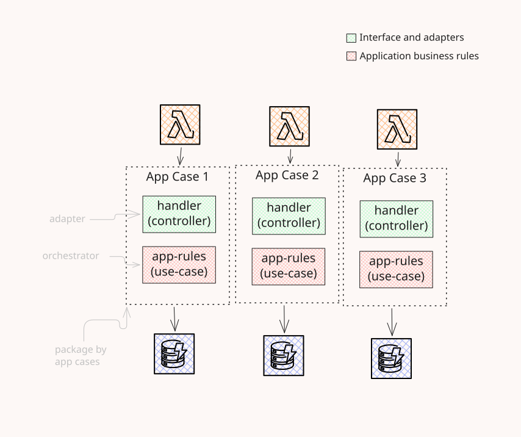
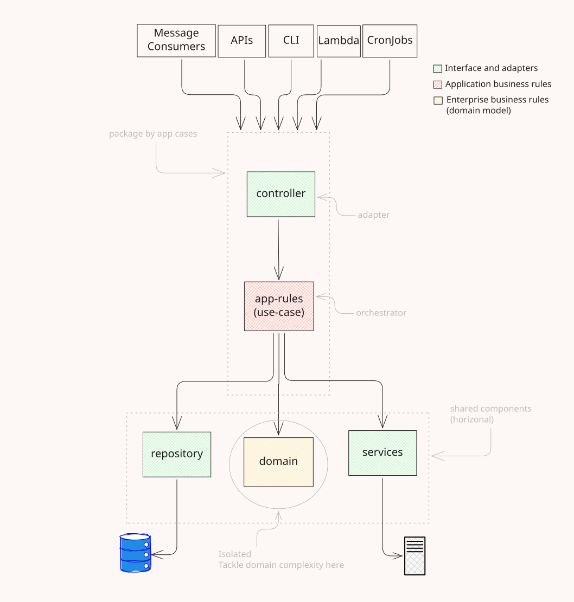

# Backend Skeleton: Vertical Slicing by App Cases

[](https://github.com/m-arrieta-r/backend-skeleton/actions/workflows/ci.yml)
[](LICENSE.md)
[](AGENTS.md)
[](https://github.com/m-arrieta-r/backend-skeleton/stargazers)

**A reference for structuring backend code so that people *and* AI coding agents can find,
change and verify one feature without reading the whole codebase.**

Organize code by **app cases**: one folder per user intent (an endpoint, a Lambda handler,
a command) containing its controller, app rules, tests and a short "slice card".
Add Clean Architecture and DDD only when the domain needs them.

```diff
- src/controllers/UserController.ts      # 1 feature = edits in 3 folders
- src/services/UserService.ts            # 40 methods, everyone edits it
- src/repositories/UserRepository.ts
+ src/modules/users/app-cases/sign-up-user/
+   README.md            # slice card: trigger, input, output, errors, rules
+   app-rules.ts         # the application rules for this one intent
+   app-rules.test.ts
+   http-controller.ts   # HTTP <-> app rules, nothing else
```

## Why it matters even more with AI agents

An agent is only as good as the context it loads and the feedback it gets.
Vertical slices give it both:

- **Small, relevant context:** one folder holds one intent, so there is no need to read a 2,000-line `UserService`.
- **Predictable shape:** every slice looks the same, so "create `cancel-order` like its siblings" just works.
- **Small blast radius:** diffs stay inside a slice and are easy for a person to review.
- **Parallel work:** several agents can each own a slice without merge conflicts.
- **Fast verification:** per-slice tests plus a [boundary checker](scripts/check-boundaries.mjs) that
  fails when an app case imports another one.

Read more in [Vertical slicing in the age of AI coding agents](doc/ai-agents/README.md).

## Start here

| If you are… | Go to |
|---|---|
| Learning the idea | [Conventions (the rules and glossary)](doc/conventions.md) · [App cases](doc/application-cases/README.md) · [Domain](doc/domain/README.md) · [Repository](doc/repository/README.md) |
| Looking for code | [**`examples/blog-api`**](examples/blog-api): runnable, tested, zero runtime dependencies |
| Comparing approaches | [Package by layer vs feature vs app case](examples/vs) |
| An AI agent | [`AGENTS.md`](AGENTS.md) · [`llms.txt`](llms.txt) |
| Adopting it in your project | [`templates/AGENTS.md`](templates/AGENTS.md) · [`create-app-case` skill](skills/create-app-case/SKILL.md) · [`check-boundaries.mjs`](scripts/check-boundaries.mjs) |

## Try it

```bash
cd examples/blog-api
npm ci
npm run check   # typecheck + boundary rules + 24 tests
npm start       # http://localhost:3000
```

## Examples

| Example | What it shows | Runnable |
|---|---|---|
| [blog-api](examples/blog-api) | Modules, app cases, optional domain, repositories, composition root, tests | ✅ |
| [simple-crud](examples/simple-crud) | MVP: one level of app cases, no domain | Shape only |
| [modular-crud](examples/modular-crud) | Same as above, grouped by module | Shape only |
| [simple-mvp-serverless](examples/simple-mvp-serverless) | One Lambda handler per app case | Shape only |
| [enterprise-project](examples/enterprise-project) | Modules with domain, repository and several transports per app case | Shape only |
| [Event Sourcing POC](https://github.com/m-arrieta-r/event-sourcing-poc) | A lending origination system built with this structure | ✅ (separate repository) |




## Motivation

Many folder conventions use a horizontal, layered structure (package by layer) and call it
"hexagonal" or "clean architecture". Those architectures say nothing about grouping files by
technical layer. They are about the **direction of dependencies**. This repository is not a new
architecture. It is a clear, repeatable way to implement vertical slicing so that the structure
*screams* the use cases.

> "A layered architecture doesn't scream anything about business domain"
> — Simon Brown, *The Missing Chapter*, in *Clean Architecture* (Robert C. Martin)

> "As an application grows, each layer can get sufficiently complex on its own that you need to modularize further. When this happens it's usually not best to use presentation-domain-data as the higher level of modules. […] once any of these layers gets too big you should split your top level into domain oriented modules which are internally layered."
> — Martin Fowler, [Presentation Domain Data Layering](https://martinfowler.com/bliki/PresentationDomainDataLayering.html)

> "The pattern has absolutely nothing to say about how you structure your application internally."
> — Alistair Cockburn, Hexagonal Architecture

## Compatibility

The structure has been used with:
- Serverless (AWS Lambda handlers)
- Node.js HTTP frameworks (Express, Koa) and CLIs
- NestJS (as an alternative to large service classes)
- MVPs without Clean/Hexagonal Architecture
- Enterprise projects with Clean Architecture and DDD

## Inspiration

- [DDD Forum](https://github.com/stemmlerjs/ddd-forum) by Khalil Stemmler
- [The Clean Architecture](https://web.archive.org/web/20140619161546/https://blog.cleancoder.com/uncle-bob/2012/08/13/the-clean-architecture.html) by Robert C. Martin
- [Screaming Architecture](https://web.archive.org/web/20140702193834/http://blog.8thlight.com/uncle-bob/2011/09/30/Screaming-Architecture.html) by Robert C. Martin
- [Vertical Slice Architecture](https://www.jimmybogard.com/vertical-slice-architecture/) by Jimmy Bogard

## Guiding principles

- **Think critically.** "Common sense" in software is often just habit.
- **Learn from others.** Many people have hit the same problems. Read them and cite them.
- **Experiment.** Better ways to build software are found by trying them.

## Contributing

Ideas, examples in other stacks and corrections are welcome. See [CONTRIBUTING.md](CONTRIBUTING.md).

## License

[MIT](LICENSE.md) © m-arrieta-r
