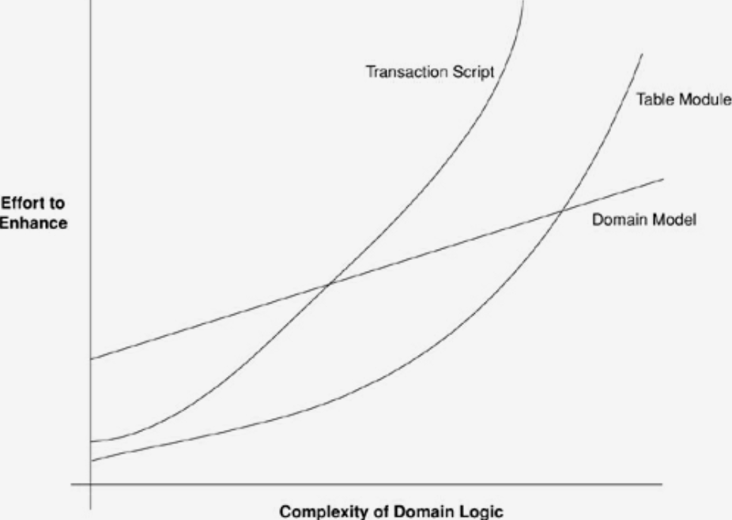

# Domain (enterprise business rules)

The domain holds entities, value objects and **invariants**: rules that must always hold,
no matter which app case runs. It is pure code with no I/O and no frameworks. It is the natural
place for DDD's tactical patterns.

**The domain is optional.** If your business rules are simple, for example in an MVP that is
mostly CRUD, app cases alone are enough. Add a `domain/` folder when the same invariant starts to
appear in more than one app case, or when the rules become complex enough to deserve their own tests.

How to decide:

> "It's not an easy choice, and it very much depends on how complex your domain logic is."
> — Martin Fowler, *Patterns of Enterprise Application Architecture*

## Domain rule or app rule?

| Domain (`domain/`) | App rules (`app-cases/<x>/app-rules.ts`) |
|---|---|
| True for every app case | Specific to one intent |
| "A post can be published only once" | "Only the author can publish their post" |
| "An email must be valid" | "An email can be registered only once" (needs the repository) |

See both kinds in [blog-api](../../examples/blog-api).

## Is DDD overrated?

> "You can only say DDD is overrated once you've achieved mastery over it. At this point, you can toss it aside. All the tactical patterns, techniques, approaches — you've already absorbed the wisdom. You're the boss. You don't need rules, ceremonies, other peoples' best practices. You set your own rules. Because you understand design, you know what's good, bad, too much design, too little, what the correct amount thereof is (see the Golden Mean) — you now have room to experiment and get creative."
> — Khalil Stemmler, [Is DDD Overrated?](https://khalilstemmler.com/blogs/domain-driven-design/is-ddd-overrated/)

> "DDD is great, but it's just one of many tools and techniques you should be aware of."
> — Stefan Tilkov, [DDD is overrated](https://tilkov.com/post/2021/03/01/ddd-is-overrated/)
