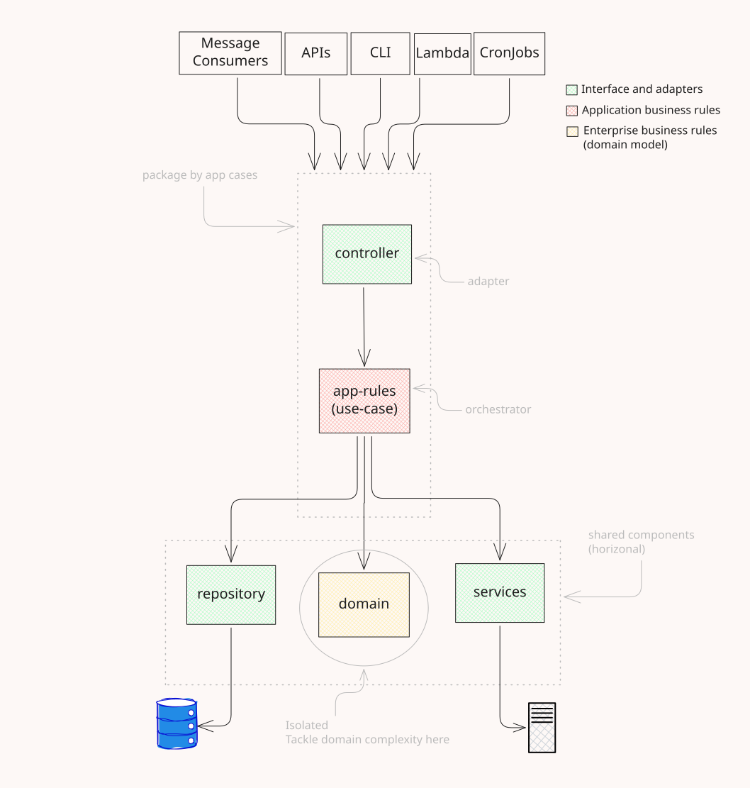

# enterprise-project (shape only)

A module with a domain and a repository. A single app case is exposed through **two transports**
(Express and Lambda) that share the same `application-rules.ts`.

```
modules/module-a/
  domain/              (+ __tests__)
  repository/          (+ __tests__)
  http-services/       clients for external HTTP APIs
  application-cases/
    app-case-a/
      application-rules.ts
      http-express-controller.ts
      lambda-handler-controller.ts
      __tests__/
```



For a runnable version of this layout, see [blog-api](../blog-api). It uses the canonical names
`app-cases/` and `app-rules.ts` from [doc/conventions.md](../../doc/conventions.md).
