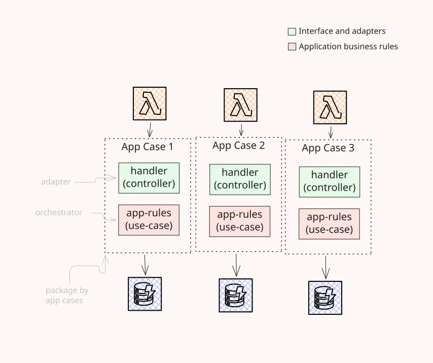

# simple-mvp-serverless (shape only)

One Lambda function per app case. The handler parses the event and the app rules decide.

```
src/
  app-case-1/  handler.ts  app-rules.ts
  app-case-2/  handler.ts  app-rules.ts
  app-case-3/  handler.ts  app-rules.ts
```



The diagram source is [`doc/diagram.excalidraw`](doc/diagram.excalidraw).
